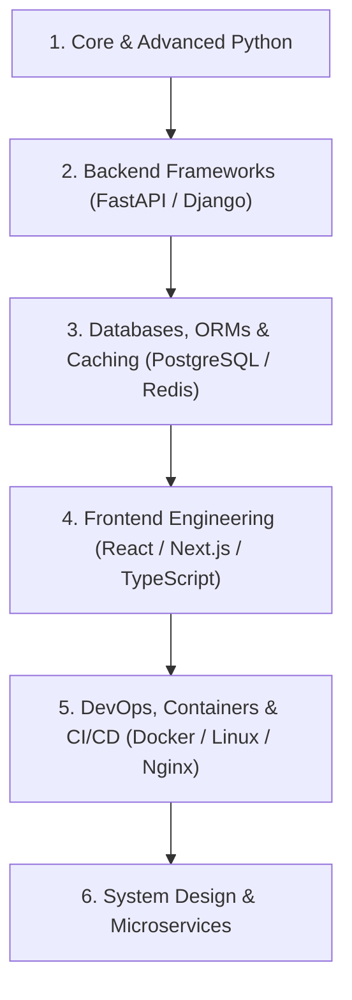

# 🚀 Awesome Python Full Stack Developer Roadmap (2026 Edition)

  
  
  
  

  A curated, comprehensive, and production-tested roadmap for becoming a high-impact <b>Python Full Stack Developer</b> in 2026. Includes architecture patterns, system design, interview cheatsheets, and starter templates.

---

## 🌟 Why Star & Follow This Repository?
- 📌 **Constantly Updated:** Keeps pace with modern async Python (FastAPI, Django 5+, Next.js, Celery, Docker).
- 🤝 **Community-Driven:** Open to contributions from developers worldwide.
- 💼 **Job-Ready:** Tailored around what engineering leads and tech companies look for in senior full stack roles.

---

## 🗺️ The Complete Learning Path

---

## 📚 Roadmap Breakdown

### 1. [🐍 Core & Advanced Python](./roadmap/01-python-core-advanced.md)
- Modern Python syntax, Type Hinting (`typing`, Pydantic).
- Generators, Decorators, Context Managers (`asyncio`, `await`).
- Object-Oriented Design Principles (SOLID) & Metaclasses.
- Performance profiling (`cProfile`, memory optimization).

### 2. [⚡ Modern Backend Frameworks](./roadmap/02-backend-fastapi-django.md)
- **FastAPI:** Async endpoints, dependency injection, automatic OpenAPI/Swagger docs, BackgroundTasks.
- **Django & Django REST Framework (DRF):** Robust ORM, migrations, user authentication, permissions, and admin dashboard.
- **Task Queues:** Celery + Redis for asynchronous background processing and email delivery.
- **WebSockets:** Real-time communications with FastAPI and Django Channels.

### 3. [🗄️ Databases & Caching](./roadmap/03-databases-caching.md)
- **Relational Databases:** PostgreSQL (Indexing, Query Optimization, ACID transactions, Connection Pooling with PgBouncer).
- **ORMs:** SQLAlchemy 2.0 (Async Session) & Django ORM.
- **In-Memory Caching:** Redis for session storage, token blacklisting, and response caching.
- **Database Migrations:** Alembic for FastAPI, native migrations for Django.

### 4. [💻 Frontend Engineering](./roadmap/04-frontend-react-nextjs.md)
- **TypeScript:** Strict type-safety, interfaces, generics.
- **React & Next.js:** Server Components (RSC), App Router, Client-side state management (Zustand / Redux Toolkit).
- **Styling:** Tailwind CSS, responsive UI design, accessible components.
- **API Integration:** TanStack Query (React Query), Axios, WebSockets.

### 5. [🚀 DevOps, Containers & Deployment](./roadmap/05-devops-docker-deployment.md)
- **Docker & Docker Compose:** Multi-stage builds for Python & Node.js, microservice orchestration.
- **Web Servers:** Nginx as reverse proxy, SSL with Certbot, Gunicorn/Uvicorn workers.
- **CI/CD:** GitHub Actions for automated testing, linting (Ruff/Black), and cloud deployment.
- **Cloud Hosting:** AWS (EC2, S3, RDS), Render, Railway, DigitalOcean.

### 6. [💼 Interview Preparation & Cheatsheet](./roadmap/06-interview-prep-cheatsheet.md)
- Top 50 Python Full Stack Interview Questions & Answers.
- System Design walkthrough: Building a scalable real-time chat & notifications system.
- REST API Design Best Practices & Error Handling.

---

## 🤝 Contributing

Contributions are warmly welcomed! Please read our [CONTRIBUTING.md](./CONTRIBUTING.md) guide to add resources, fix typos, or expand interview sections.

---

## 👨‍💻 Maintainer
Maintained with ❤️ by **[Shibin P](https://github.com/shibinputhramannil)**. 
- Star this repository if you find it helpful!
- Follow for weekly updates and open-source releases.

---

## 📄 License
This project is licensed under the [MIT License](./LICENSE).
